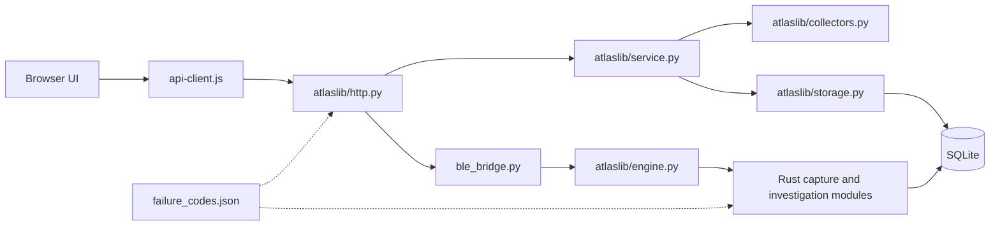

# Atlas module boundaries

Atlas uses a small Python HTTP/collection host, a Rust investigation executable, and local browser assets. It has no application framework or runtime Python package dependency.



| Module | Responsibility | Does not own |
|---|---|---|
| `atlas.py` | CLI, bootstrap, localhost listener, compatibility exports | HTTP routing, parsing, SQL queries |
| `atlaslib/config.py` | Python paths and execution/request limits | Mutable job state |
| `atlaslib/errors.py` | Typed failure envelopes, SQLite classification, redacted diagnostic logging | Collection or retry execution |
| `atlaslib/http.py` | JSON framing, method/origin validation, route dispatch, correlation IDs, HTTP status | Investigation algorithms |
| `atlaslib/engine.py` | Native launch, concurrency slots, deadline, protocol validation | Sensor authentication or SQL |
| `atlaslib/storage.py` | SQLite connection lifecycle and legacy schema initialization | Network I/O |
| `atlaslib/networks.py` | Active Wi-Fi context tracking and persistent network history | SSID inference or network probing |
| `atlaslib/service.py` | Inventory and collector orchestration, locks, job cleanup, runtime health | HTTP responses |
| `atlaslib/collectors.py` | Network probes and description reads | Database persistence or scheduling |
| `ble_bridge.py` | Legacy BLE import/history adapters and inventory queries | Subprocess failure classification |
| `native/src/capture.rs` | BLE parsing and bounded ARM64/portable hex decoding | Files, network, database access |
| `native/src/kernels.rs`, `research.S` | Safe statistical/bit-distance wrappers and ARM64 kernels | Database and network access |
| `native/src/investigate/research.rs`, `research_network.rs` | Bounded descriptive analysis, manifests and research notebooks | Active probes or causal/identity inference |
| `native/src/errors.rs` | Typed native failures and embedded shared catalog | Message-string classification |
| `native/src/investigate/mod.rs` | Shared SQLite initialization, dispatch and request validation | HTTP sockets |
| `native/src/investigate/captures.rs` | Capture transactions, search, comparison and replay | Sensor credentials |
| `native/src/investigate/alerts.rs` | Rules, snapshots and alert state | Network probing |
| `native/src/investigate/sensors.rs` | Credential lifecycle and atomic ingestion | Active collection |
| `native/src/investigate/overview.rs` | Observation graph and collection health | Physical-topology inference |
| `native/src/investigate/reports.rs` | Escaped standalone evidence reports | External assets or executable report scripts |
| `static/api-client.js` | Shared fetch/error contract and diagnostic presentation | Automatic mutation retries |
| `static/app.js`, `static/investigate.js` | Inventory and investigation workspaces | Database or credential validation |

The public Python imports `from atlas import Atlas, handler, now` remain available. The existing `atlas.shutil`, `atlas.subprocess` and `atlas.http` patch points are compatibility aliases, not a reason to put new logic in the CLI.

## Ownership and cleanup

A collector acquires its lock before its thread starts. The worker owns that lock until its `finally` block releases it. A failed thread launch releases the lock immediately. Run metrics and investigation synchronization have separate failure fields, so a failure there cannot permanently mark a collector busy or discard successful observations.

Native operations acquire one of two slots, have a bounded queue wait and execution deadline, and always release the slot in `finally`. Native stderr is a structured failure envelope. Unknown exit/protocol failures are classified without forwarding raw stderr. SQLite failure classification uses error types and primary SQLite codes, never substring matching.

Capture and sensor writes retain their existing transaction semantics. This reorganization does not rewrite stored observations, source logs, capture identifiers or credentials. Schema changes are still owned by the existing Python/Rust initializers; a new migration framework has not been introduced.

## Change discipline

- Add a failure code to `failure_codes.json` when introducing a new failure meaning. Do not repurpose a published code.
- Rebuild Rust after changing the shared catalog; Rust embeds it at compile time.
- Raise typed input failures at validation boundaries. Unexpected `ValueError` is an internal failure, not automatically a user error.
- Keep secrets, body text, SQL, raw subprocess stderr and source lines out of diagnostics. Logs contain safe frame locations and request IDs.
- Test failing dependency paths and cleanup, not only success cases.
- Keep networking, HTTP status mapping, subprocess control and SQL ownership in their respective modules.

## Checks

```sh
cargo fmt --manifest-path native/Cargo.toml --all --check
cargo test --manifest-path native/Cargo.toml --locked
cargo build --manifest-path native/Cargo.toml --release --locked
python3 -m unittest discover -s tests -v
black --check atlas.py ble_bridge.py atlaslib tests/test_failures.py
pyflakes3 atlas.py ble_bridge.py atlaslib tests/test_failures.py
node --check static/api-client.js
node --check static/app.js
node --check static/investigate.js
```

Black and Pyflakes are development tools only. The app needs no pip packages at runtime.

## Observer and evidence contracts

`atlaslib/observer.py` owns an atomic mode-0600 `<database>.status.json` surface and the persisted singleton observer_state. It publishes on start, each collector completion and graceful stop. A two-second network-observer tick checkpoints wall/monotonic time in SQLite. Status contains last successful collector completion, current wall clock, signed age and overdue flag; it is not a heartbeat guarantee. A successful collector run means no collector/metrics error, not a responding device. Snapshot, alert or status-file failure is independently visible.

`collection_gaps` records restart windows, observer delays greater than interval, backwards wall time, and wall/monotonic discrepancies greater than interval. Restart gaps have unknown monotonic duration. A gap is assigned the context active when the gap is recorded; it does not prove that context remained available throughout the gap. Clock jumps are evidence about the observer's clocks, not a suspension detector. The latest 30 gaps appear in health; GET /api/v2/gaps provides context-scoped keyset pages (limit 1–100).

`evidence_schema.sql` is shared by Python Store and Rust evidence initialization. Additive batch_id columns link observations, events, identities, collection runs, capture sessions, sensor IP posts and alerts to immutable collection_batches. Local batches freeze collector source SHA-256, method version, all selected target ports, worker counts, timeout/bounds, network-context record and a copy of the Python catalog loaded at host start. Imports and sensor posts store their own method/provenance and the Rust-embedded catalog; remote collection method and network fingerprint remain unknown. Legacy evidence has null batch_id; no contract is reconstructed for it. Contracts remain retrievable after retention via GET /api/v2/collection_contract?id=... . Research returns all batch IDs in its bounded sample and expands at most 100 contracts, explicitly flagging omitted expansions. Alerts retain the contract of their generating evidence, without rewriting historical alerts on refresh.

`native/src/investigate/retention.rs` uses BEGIN IMMEDIATE for a context-scoped cutoff computed once inside the transaction. POST /api/v2/purge requires network_id and integer age_seconds (1–315360000). It removes older local TCP observations/events only; optional delete_snapshot_ids contains at most 100 positive IDs, each verified against an IP target in that context and subject to the same cutoff. It preserves contexts, targets, identities, unmarked snapshots, runs, gaps, alerts, contracts, BLE imports and sensor posts. Counts report actual DELETE results. Invalid or cross-context snapshot IDs roll back everything. Retention does not VACUUM or reclaim file size immediately. Persistent ID watermarks prevent new observations/events/snapshots reusing purged evidence IDs or bypassing alert cursors.

`native/src/investigate/bundle.rs` exports a transactionally consistent JSON archive for one context. It includes up to 100 local observations, referenced contracts and their collection-time catalogs, the context/fingerprint, up to 100 latest context gaps, current failure catalog separately labeled, and exact research build/kernel hashes. Keyset cursor and explicit truncation flags distinguish a page from a complete inventory. An 8 MB encoded archive ceiling rejects oversized pages. BLE/sensor evidence has no proven context membership and is excluded. This is an export, not a restorable database or an authenticity signature; the full SQLite backup remains available separately.

Research notebooks now embed the full analysis result including build source hashes, kernel version, configured limits and truncation flags. Generic capture reports include this same bounded research evidence. Offline numerical methods and statistical interpretations are unchanged.

## Local control boundary

A 256-bit random token is generated per host instance; ATLAS_CONTROL_TOKEN can instead supply exactly 64 hex characters. The CLI prints it once after binding. All /api/ routes require X-Atlas-Control, compared in constant time. This stricter read policy covers existing read-side snapshot/alert synchronization and all exports, including /api/backup. Static assets remain open. The user enters the startup token in the dashboard; api-client.js holds it only in page memory, injects it in headers, and uses authenticated fetch/blob for backup links. No URL tokens, embedded asset secrets, cookies or persistent browser storage are used. Sensor Bearer authentication remains independent. Origin must match the request Host; API Host must be 127.0.0.1 or localhost with the actual bound port. No cross-origin CORS access is granted.

The token protects the local HTTP boundary, not an untrusted process sharing the same Android/Linux user or database directory. Files and process environment remain subject to OS permissions. A crash may leave collector completion/commit outcomes unknown. No continuous observation claim follows from a running HTTP process.

## Optional user-supplied Wi-Fi context

`atlaslib/wifi_context.py` reads `<database>.wifi-context.json` (or ATLAS_WIFI_CONTEXT_FILE). No writer, Android permission grant, or radio bridge is installed. Reads are capped at 4096 bytes and require an object with exact visible address/cidr, timezone-aware observed_at aged at most 120 seconds (up to 5 seconds in the future), and at least one valid ssid, bssid or network_token. SSID is at most 32 UTF-8 bytes, BSSID is a MAC-shaped string, network_token is at most 128 bytes; control characters are rejected. Only these optional fields affect the existing fingerprint hash; provenance and observed_at do not. Raw validated visible fields and the unverified hint provenance are retained in network_contexts.visible_evidence and frozen batch contracts. Absent, expired, unreadable or malformed files fall back to address/mask with typed diagnostics. This can cause a context transition when hints expire; it never asserts verified SSID membership for other devices.
