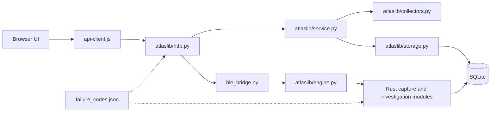

# Atlas module boundaries

Atlas uses a small Python HTTP/collection host, a Rust investigation executable, and local browser assets. It has no application framework or runtime Python package dependency.



| Module | Responsibility | Does not own |
|---|---|---|
| `atlas.py` | CLI, bootstrap, localhost listener, compatibility exports | HTTP routing, parsing, SQL queries |
| `atlaslib/config.py` | Python paths and execution/request limits | Mutable job state |
| `atlaslib/errors.py` | Typed failure envelopes, SQLite classification, redacted diagnostic logging | Collection or retry execution |
| `atlaslib/http.py` | JSON framing, method/origin validation, route dispatch, correlation IDs, HTTP status | Investigation algorithms |
| `atlaslib/engine.py` | Native launch, concurrency slots, deadline, protocol validation | Sensor authentication or SQL |
| `atlaslib/storage.py` | SQLite connection lifecycle and legacy schema initialization | Network I/O |
| `atlaslib/networks.py` | Active Wi-Fi context tracking and persistent network history | SSID inference or network probing |
| `atlaslib/service.py` | Inventory and collector orchestration, locks, job cleanup, runtime health | HTTP responses |
| `atlaslib/collectors.py` | Network probes and description reads | Database persistence or scheduling |
| `ble_bridge.py` | Legacy BLE import/history adapters and inventory queries | Subprocess failure classification |
| `native/src/capture.rs` | BLE parsing and bounded ARM64/portable hex decoding | Files, network, database access |
| `native/src/kernels.rs`, `research.S` | Safe statistical/bit-distance wrappers and ARM64 kernels | Database and network access |
| `native/src/investigate/research.rs`, `research_network.rs` | Bounded descriptive analysis, manifests and research notebooks | Active probes or causal/identity inference |
| `native/src/errors.rs` | Typed native failures and embedded shared catalog | Message-string classification |
| `native/src/investigate/mod.rs` | Shared SQLite initialization, dispatch and request validation | HTTP sockets |
| `native/src/investigate/captures.rs` | Capture transactions, search, comparison and replay | Sensor credentials |
| `native/src/investigate/alerts.rs` | Rules, snapshots and alert state | Network probing |
| `native/src/investigate/sensors.rs` | Credential lifecycle and atomic ingestion | Active collection |
| `native/src/investigate/overview.rs` | Observation graph and collection health | Physical-topology inference |
| `native/src/investigate/reports.rs` | Escaped standalone evidence reports | External assets or executable report scripts |
| `static/api-client.js` | Shared fetch/error contract and diagnostic presentation | Automatic mutation retries |
| `static/app.js`, `static/investigate.js` | Inventory and investigation workspaces | Database or credential validation |

The public Python imports `from atlas import Atlas, handler, now` remain available. The existing `atlas.shutil`, `atlas.subprocess` and `atlas.http` patch points are compatibility aliases, not a reason to put new logic in the CLI.

## Ownership and cleanup

A collector acquires its lock before its thread starts. The worker owns that lock until its `finally` block releases it. A failed thread launch releases the lock immediately. Run metrics and investigation synchronization have separate failure fields, so a failure there cannot permanently mark a collector busy or discard successful observations.

Native operations acquire one of two slots, have a bounded queue wait and execution deadline, and always release the slot in `finally`. Native stderr is a structured failure envelope. Unknown exit/protocol failures are classified without forwarding raw stderr. SQLite failure classification uses error types and primary SQLite codes, never substring matching.

Capture and sensor writes retain their existing transaction semantics. This reorganization does not rewrite stored observations, source logs, capture identifiers or credentials. Schema changes are still owned by the existing Python/Rust initializers; a new migration framework has not been introduced.

## Change discipline

- Add a failure code to `failure_codes.json` when introducing a new failure meaning. Do not repurpose a published code.
- Rebuild Rust after changing the shared catalog; Rust embeds it at compile time.
- Raise typed input failures at validation boundaries. Unexpected `ValueError` is an internal failure, not automatically a user error.
- Keep secrets, body text, SQL, raw subprocess stderr and source lines out of diagnostics. Logs contain safe frame locations and request IDs.
- Test failing dependency paths and cleanup, not only success cases.
- Keep networking, HTTP status mapping, subprocess control and SQL ownership in their respective modules.

## Checks

```sh
cargo fmt --manifest-path native/Cargo.toml --all --check
cargo test --manifest-path native/Cargo.toml --locked
cargo build --manifest-path native/Cargo.toml --release --locked
python3 -m unittest discover -s tests -v
black --check atlas.py ble_bridge.py atlaslib tests/test_failures.py
pyflakes3 atlas.py ble_bridge.py atlaslib tests/test_failures.py
node --check static/api-client.js
node --check static/app.js
node --check static/investigate.js
```

Black and Pyflakes are development tools only. The app needs no pip packages at runtime.
